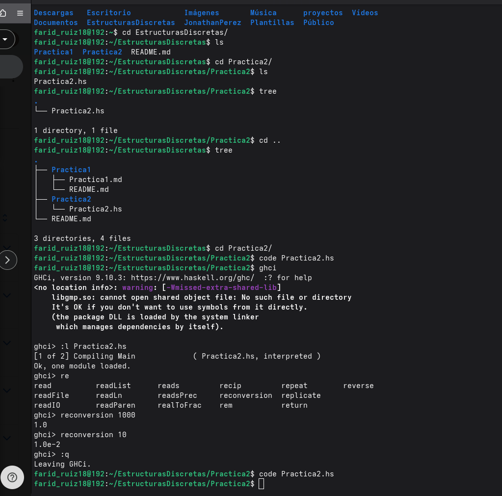

# Práctica 02: Thinking in Haskell

## Objetivo

Aprender a implementar funciones en Haskell.

## Tiempo requerido

Aproximadamente 6 horas.

## Evidencia de ejecución

## Comentarios extra

Definitivamente pude hacer esta practica gracias aun archivo phyton que hice en un curso de verano, de este entre comillas archivo\programa me basé por que llegue en un momento donde me bloquee.

Tambien destaco que tuve que hacer uso de un cuaderno para poder resolver la parate de la estafa debido a que en mi parecer esta parte no quedaba tan claro pero una vez organice mis pensamientos en una hoja finalmente pude resolver el problema.

## Imagen extra

