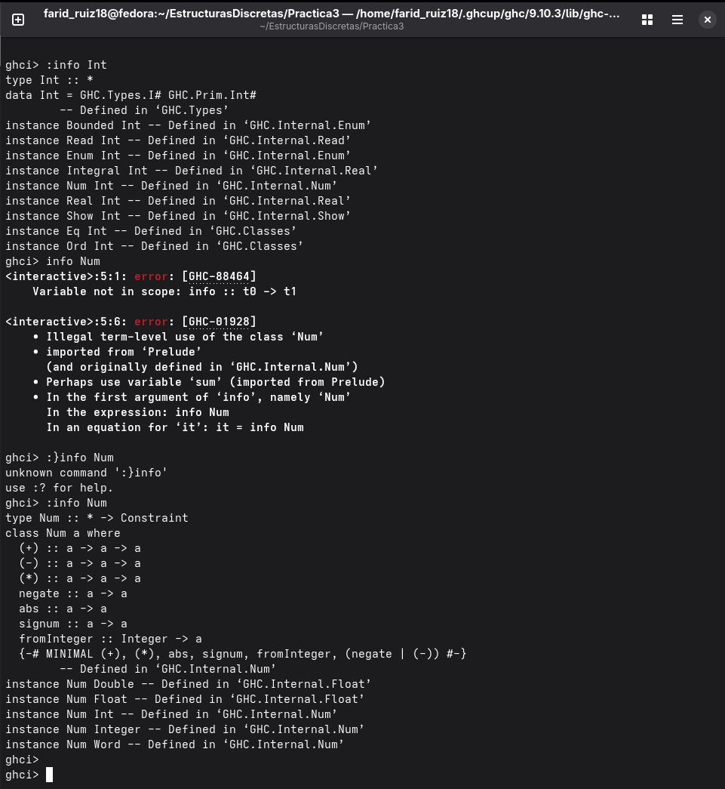

Práctica 3: Mis tipos de datos y listas por comprensión

Objetivo

El objetivo de esta práctica fue aprender a trabajar con tipos de datos propios en Haskell y utilizar listas por comprensión para resolver distintos problemas. 

También practiqué el uso de funciones, la importación de módulos y operaciones con números, como identificar números pares, primos y coprimos.

Tiempo requerido

Aproximadamente 2 horas y media

Ejercicio favorito

Mi ejercicio favorito fue el de soloPares, porque me permitió practicar las listas por comprensión y utilizar la función esParBit importada desde otro módulo. Me pareció interesante ver cómo se pueden combinar funciones para obtener únicamente los elementos que cumplen una condición.

Diferencia entre Num y Int.

segun lo que entendi con respecto a la informacion que me devolvio los comandos ":Info Num", es que "Num" es una clase de tipos o Typeclass que define operaciones aritmeticas, entre ellas, la suma, la resta, la division, etc.

Int es un tipo concreto que representa números enteros, al igual que "Integer","Float" y "Double", es una instancia dentro de Num.

La Chivita Recursiva

La canción Sal de ahí, chivita, chivita permite comprender el concepto de recursión porque cada estrofa agrega un nuevo elemento a una secuencia que ya existe, primero se necesita al lobo para sacar a la chiva, después, se incorpora el palo para hacer que el lobo actúe, y así sucesivamente, cada nueva etapa conserva las acciones anteriores y agrega otra dependencia, esto se parece a una función recursiva, que se llama a sí misma para resolver un problema mediante pasos relacionados, el caso base es la condición que permite detener la recursión, en la canción, la cadena termina cuando los personajes consiguen que la chiva salga, sin un caso base, un proceso recursivo podría continuar indefinidamente.
